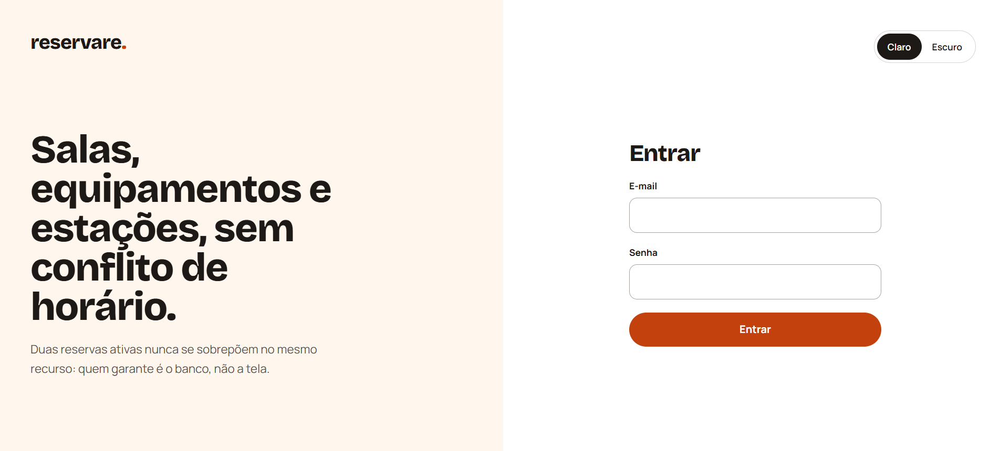
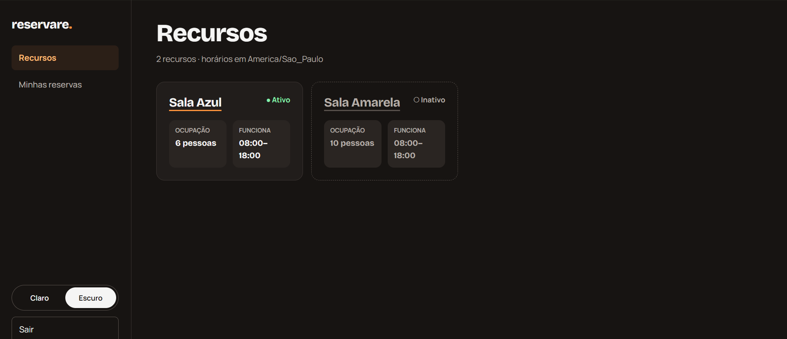
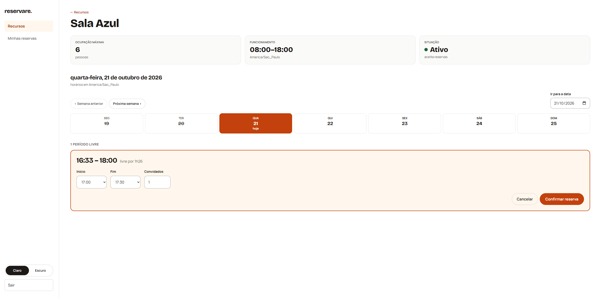
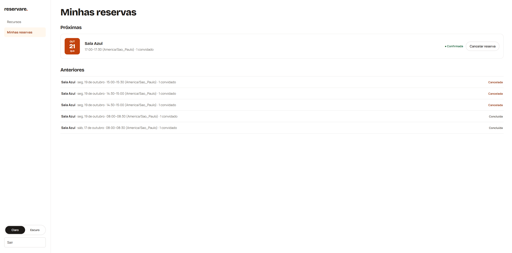

# 📅 Reservare

[](https://github.com/PatriciaCorreiaSI/sistema-reservare/actions/workflows/ci.yml)

Sistema de reserva de recursos compartilhados — salas, equipamentos e estações de trabalho — construído com foco em **integridade de dados sob concorrência**.

> ⚠️ **Em construção.** Este repositório documenta um projeto em andamento, etapa por etapa.
> Fase atual: **Etapa 9 — vitrine.** O sistema está no ar, com backup noturno e restauração testada.

## Experimente

**https://reservare.onrender.com**

| Conta | E-mail | Senha |
|---|---|---|
| Ana | `ana@reservare.example` | `demonstracao` |
| Bruno | `bruno@reservare.example` | `demonstracao` |

São contas de demonstração, com três recursos e reservas de exemplo nos três estados (confirmada,
concluída, cancelada). Duas coisas a saber:

- **A primeira visita pode levar cerca de um minuto.** O plano grátis adormece o serviço sem uso, e
  ele acorda no primeiro pedido.
- **A demonstração se reinicia sozinha.** A cada partida do serviço, as reservas das contas de
  demonstração voltam ao estado inicial ([ADR 0033](docs/adr/0033-semear-demonstracao-na-partida.md)):
  o que você reservar pode sumir.

<picture>
  <source media="(prefers-color-scheme: dark)" srcset="docs/telas/login-escuro.png">
  
</picture>

Mais telas em [Telas](#telas).

---

## O problema

Uma equipe compartilha recursos limitados e precisa reservá-los por janelas de tempo. O desafio não é o cadastro — é garantir que **duas pessoas nunca reservem o mesmo recurso no mesmo horário**, inclusive quando as duas requisições chegam no mesmo instante.

## A regra que dá razão a este projeto

> **Duas reservas ativas nunca podem se sobrepor no mesmo recurso.**

Verificar disponibilidade antes de inserir **não** resolve isso: entre a verificação e a gravação existe uma janela em que outra transação insere. Por isso a garantia é declarada no próprio PostgreSQL, com uma constraint de exclusão sobre `tstzrange` — de forma que a regra não dependa de o código lembrar de conferir.

```sql
CONSTRAINT ex_reserva_sem_sobreposicao
    EXCLUDE USING gist (id_recurso WITH =, periodo WITH &&)
    WHERE (cancelada_em IS NULL)
```

Lê-se: *para qualquer par de linhas, se o recurso é o mesmo **e** os períodos se sobrepõem, recuse* — considerando apenas as reservas que não foram canceladas. O porquê desse `WHERE`, e das duas alternativas descartadas, está no [ADR 0007](docs/adr/0007-predicado-pelo-cancelamento.md).

Demonstrar isso, com teste de concorrência que prove o comportamento, é o objetivo central do projeto.

### Verificando o invariante

O esquema é criado pela migration, e a prova roda contra o banco que ela construiu — em SQL puro,
sem nenhuma linha de Python:

```bash
docker compose up -d db                        # espere ficar (healthy)
cd backend && uv run alembic upgrade head      # cria as tabelas, a extensão e a EXCLUDE
cd ..

docker compose cp docs/prova-invariante.sql db:/tmp/prova.sql
docker compose exec db sh -c 'psql -U "$POSTGRES_USER" -d "$POSTGRES_DB" -f /tmp/prova.sql'
```

[`docs/prova-invariante.sql`](docs/prova-invariante.sql) percorre sete casos, cada um com o resultado esperado escrito antes de rodar — entre eles: reservas sobrepostas são recusadas; reservas que apenas se encostam (`[14h,16h)` e `[16h,18h)`) são as duas aceitas; e cancelar uma reserva devolve o horário para quem vier depois.

---

## Telas

O app tem tema claro e escuro: na primeira visita segue o do sistema, e a escolha feita na tela fica guardada no navegador. As telas abaixo mostram os dois.

Depois de entrar, a lista de recursos, aqui no tema escuro. Recurso inativo aparece, mas não aceita reserva.



Ao abrir um recurso, os horários livres do dia, no fuso dele: a faixa da semana muda o dia pela URL, e clicar numa lacuna abre o formulário de reserva. Se outra pessoa reservar o mesmo horário antes, o banco recusa e a tela explica o conflito.



Por fim, minhas reservas: as próximas em cartões, com o cancelamento confirmado numa caixa de diálogo; as anteriores em linhas, concluídas ou canceladas.



---

## Status

| Etapa | Situação |
|---|---|
| Modelagem de dados | ✅ concluída |
| Fundação: ambiente, container, lint | ✅ concluída |
| Migrations e constraints | ✅ concluída — `alembic upgrade head` cria as três tabelas, a extensão e a `EXCLUDE` num banco vazio; `downgrade base` desfaz |
| API em camadas | ✅ concluída — CRUD de `recurso` em router → service → repository, com testes isolados por transação num banco próprio |
| Autenticação e autorização | ✅ concluída — login, refresh com rotação e detecção de reuso, logout que revoga de verdade, cadastro de usuário só para admin ([ADR 0012](docs/adr/0012-jwt-curto-com-refresh-no-banco.md), [ADR 0013](docs/adr/0013-transportar-token-no-cabecalho-authorization.md)) |
| Reservas, concorrência e estados | ✅ concluída — criar, listar, consultar e cancelar reservas, consulta de horários livres, sobreposição recusada pelo banco e traduzida em `409`; testes de IDOR e de concorrência verdes ([ADR 0014](docs/adr/0014-traduzir-violacao-da-constraint-pelo-nome.md) a [0019](docs/adr/0019-disponibilidade-como-lacunas-livres.md)) |
| Testes e integração contínua | ✅ concluída — CI verde a cada push: lint, tipos, a suíte de testes com relatório de cobertura e vaivém das migrations contra Postgres de serviço ([ADR 0021](docs/adr/0021-testar-pelo-que-a-coisa-testada-depende.md), [ADR 0022](docs/adr/0022-container-de-servico-e-variaveis-no-workflow.md)); cobertura lida como alarme, e cada linha sem teste tem o porquê no ROADMAP |
| Front-end | ✅ concluída — login, recursos, horários livres, reservar e cancelar, em tema claro e escuro ([ADR 0023](docs/adr/0023-guardar-refresh-em-cookie-httponly.md) a [0027](docs/adr/0027-estilizar-front-com-tailwind.md)); 16 testes de ponta a ponta (Playwright) no CI |
| Deploy | ✅ concluída — no ar em [reservare.onrender.com](https://reservare.onrender.com): API no Render e banco no Neon, uma imagem só para a API e as telas, deploy só com o CI verde, logs em JSON com um ID de correlação que a tela mostra num erro do servidor, e [backup noturno](#backup-e-restauração) restaurado e conferido antes de ser guardado ([ADR 0028](docs/adr/0028-hospedar-api-no-render-e-banco-no-neon.md) a [0034](docs/adr/0034-construir-imagem-da-raiz-do-repositorio.md)) |
| Vitrine | 🔨 em curso |

Nada é listado como pronto antes de estar funcionando.

---

## Stack

**Back-end** — Python 3.14 · FastAPI · SQLAlchemy 2.0 · Pydantic v2 · Alembic · PostgreSQL 16 · `pwdlib` (Argon2) · PyJWT
**Front-end** — Vite · React · TypeScript · TanStack Query · Tailwind CSS v4
**Qualidade** — pytest · Playwright · ruff · mypy · GitHub Actions
**Infra** — Docker · Docker Compose · Render · Neon

As justificativas de cada escolha estão no [roadmap](docs/ROADMAP.md#4-stack-e-por-quê).

---

## Desenvolvimento

Requisito: [uv](https://docs.astral.sh/uv/). Ele lê o `backend/.python-version` e instala o Python 3.14 sozinho — não é preciso ter a versão na máquina.

```bash
git clone https://github.com/PatriciaCorreiaSI/sistema-reservare.git
cd sistema-reservare
cp .env.example .env            # valores de desenvolvimento, já prontos
docker compose up -d db         # espere ficar (healthy) em `docker compose ps`

cd backend
uv sync
uv run alembic upgrade head     # cria as tabelas no banco do compose
uv run uvicorn app.main:app --reload
```

A API sobe em `http://127.0.0.1:8000` — `/health` responde `200`, e `/docs` traz a documentação interativa. O `.env` é obrigatório: a URL do banco é montada a partir dele na importação, sem valor padrão — a ausência de uma chave falha alto, de propósito.

Os valores do `.env.example` são os mesmos que o CI já publica e servem só para a cópia local, que escuta apenas em `127.0.0.1`. A demonstração no ar usa segredos próprios, que nunca passaram pelo repositório. Para publicar o projeto em outro lugar, troque todos — em especial o `JWT_SEGREDO`: quem o conhece consegue assinar um token de admin.

Para ver o sistema como ele vai para produção — a mesma imagem serve a API e as telas, e migra o banco ao subir:

```bash
docker compose up -d --build    # constrói o front e a API numa imagem só
```

As telas abrem em `http://localhost:8000` (`localhost`, não `127.0.0.1`: o cookie da sessão é `Secure`, e só `localhost` conta como contexto seguro em `http://`). Para entrar, o banco precisa de um admin: `uv run python -m app.comandos.criar_admin`, de `backend/`.

### Testes

Precisam do `db` no ar e de um banco `reservare_test`, criado uma vez. O `conftest.py` aplica as migrations nele a cada rodada; cada teste roda numa transação desfeita no fim ([ADR 0011](docs/adr/0011-isolar-teste-em-transacao-desfeita-no-fim.md)).

```bash
docker compose exec db sh -c 'createdb -U $POSTGRES_USER reservare_test'   # uma vez
cd backend && uv run pytest
```

Os testes que dão razão ao projeto são os de concorrência: duas requisições liberadas no mesmo instante disputam o mesmo horário, e a resposta tem de ser um `201` e um `409` — `uv run pytest -m concorrencia`.

No CI, o mesmo `pytest` roda com `--cov=app --cov-report=term-missing`: o relatório lista as linhas
que nenhum teste executou e nunca reprova o push — cobertura é alarme, não meta
([ADR 0021](docs/adr/0021-testar-pelo-que-a-coisa-testada-depende.md)).

Os testes de ponta a ponta (Playwright, só Chromium) precisam do `db` no ar e de um banco
`reservare_e2e`, criado como o de teste (`createdb -U $POSTGRES_USER reservare_e2e`). O próprio Playwright sobe a API em `:8001` e o
Vite em `:5174` — portas próprias, para nunca gravar no banco de desenvolvimento — e zera o
`reservare_e2e` antes de cada rodada:

```bash
cd frontend
npx playwright install chromium   # uma vez, baixa o navegador
npx playwright test
```

### Verificação antes do commit

O repositório usa `pre-commit` para rodar `ruff` e `mypy` a cada `git commit`. **Depois de clonar, o hook precisa ser instalado uma vez:**

```bash
cd backend && uv run pre-commit install
```

Esse passo não é automático, e a razão importa: o hook do Git vive em `.git/hooks/`, que **não é versionado** e portanto não vem junto no clone. Sem o comando acima, os commits passam sem verificação nenhuma — e nada na tela avisa que a proteção não está ali.

Para rodar as verificações à mão, sem commitar:

```bash
cd backend && uv run pre-commit run --all-files
```

---

## Backup e restauração

Toda noite, às 3h17 de Brasília, o workflow [`backup.yml`](.github/workflows/backup.yml) faz o
dump do banco de produção com um papel do Postgres que só lê, **restaura o dump num Postgres
descartável e o confere** — o esquema pelo `alembic check`, a `EXCLUDE` e a contagem de cada
tabela contra a produção — e só então o criptografa com [`age`](https://github.com/FiloSottile/age)
e o guarda como artifact, por 90 dias. Se a restauração ou a conferência falhar, o workflow fica
vermelho e nada é guardado ([ADR 0032](docs/adr/0032-backup-noturno-com-restauracao-testada.md)).
O botão **Run workflow** roda um backup fora de hora.

O workflow só tem a chave **pública**: o backup se tranca no GitHub e só abre com a chave privada,
que fica com a autora, fora do repositório.

### Restaurar um backup

Ensaiado de ponta a ponta em 2026-10-28, no Windows (PowerShell), restaurando num banco à parte do
Postgres do compose. Precisa do `db` no ar, do `age` (`winget install --id FiloSottile.age
--exact`, e um terminal aberto depois da instalação) e do arquivo da chave privada.

1. Na execução mais recente do workflow **Backup**, em **Artifacts**, baixar o `backup-AAAA-MM-DD`
   (vem como `.zip`).
2. Abrir e descriptografar, da raiz do repositório:

   ```powershell
   $pasta = "$env:TEMP\restauracao"
   New-Item -ItemType Directory -Force $pasta | Out-Null
   Expand-Archive "$env:USERPROFILE\Downloads\backup-AAAA-MM-DD.zip" -DestinationPath $pasta
   age -d -i "<arquivo da chave privada>" -o "$pasta\reservare.dump" "$pasta\reservare.dump.age"
   ```

3. Restaurar num banco novo, `restauracao`, sem tocar no de desenvolvimento:

   ```powershell
   docker compose cp "$pasta\reservare.dump" db:/tmp/reservare.dump
   docker compose exec -T db sh -c 'createdb -U $POSTGRES_USER restauracao && pg_restore -U $POSTGRES_USER -d restauracao --exit-on-error --no-owner --no-privileges /tmp/reservare.dump && echo RESTAURADO'
   ```

4. Conferir: as contagens têm que ser as do passo **Conferir as contagens** daquela execução, e a
   `EXCLUDE` tem que voltar com `contype` = `x`.

   ```powershell
   @'
   SELECT 'alembic_version', count(*) FROM alembic_version
   UNION ALL SELECT 'recurso', count(*) FROM recurso
   UNION ALL SELECT 'refresh_token', count(*) FROM refresh_token
   UNION ALL SELECT 'reserva', count(*) FROM reserva
   UNION ALL SELECT 'usuario', count(*) FROM usuario
   ORDER BY 1;
   SELECT conname, contype FROM pg_constraint WHERE conname = 'ex_reserva_sem_sobreposicao';
   '@ | Set-Content -Encoding ascii "$pasta\conferir.sql"
   docker compose cp "$pasta\conferir.sql" db:/tmp/conferir.sql
   docker compose exec -T db sh -c 'psql -U $POSTGRES_USER -d restauracao -f /tmp/conferir.sql'
   ```

5. Limpar — o dump aberto é a cópia legível dos dados de produção:

   ```powershell
   docker compose exec -T db sh -c 'dropdb -U $POSTGRES_USER restauracao && rm /tmp/reservare.dump /tmp/conferir.sql && echo LIMPO'
   Remove-Item -Recurse -Force $pasta
   ```

Duas armadilhas do PowerShell 5.1 que o roteiro já contorna: ele come as aspas duplas dentro de um
argumento de executável nativo (por isso `$POSTGRES_USER` vai sem aspas, e o SQL vai por arquivo,
não por `psql -c`), e põe uma marca invisível (BOM) no começo do que manda por pipe (por isso a
chave é lida de arquivo, e o `.sql` é gravado em `ascii`).

Devolver um backup ao Neon, no lugar do banco de produção, ainda não foi ensaiado.

---

## Documentação

| Documento | O que contém |
|---|---|
| [`docs/ROADMAP.md`](docs/ROADMAP.md) | Escopo, plano de execução e o que cada etapa ensina |
| [`docs/modelo.md`](docs/modelo.md) | Modelo de dados, restrições e regras de negócio |
| [`docs/api.md`](docs/api.md) | Contrato HTTP: schemas por direção, rotas, códigos de resposta e o porquê de cada escolha |
| [`docs/esquema-alvo.sql`](docs/esquema-alvo.sql) | O DDL escrito à mão na Etapa 1 — congelado como registro histórico; a partir da migration, a verdade sobre o esquema é o Alembic |
| [`docs/prova-invariante.sql`](docs/prova-invariante.sql) | Sete casos que demonstram, em SQL puro, o que o banco aceita e o que recusa |
| [`docs/adr/`](docs/adr/) | Decisões de arquitetura, com alternativas descartadas e consequências |
| [`docs/aprendizados.md`](docs/aprendizados.md) | Um conceito por linha — o que cada etapa ensinou na prática |

---

## Sobre este projeto

É um projeto de estudo, construído deliberadamente como exercício de **engenharia de software** e não como demonstração de framework. O tema é o veículo; o conteúdo é modelagem com garantias no banco, concorrência, estratégia de testes e automação.

Sobre o uso de IA: ela é usada como revisora e tutora — para explicar conceitos, apontar falhas e sugerir alternativas. As decisões de arquitetura são minhas, ficam registradas em ADRs com as opções que descartei, e vale uma regra simples: **nenhuma linha entra neste repositório que eu não consiga explicar em voz alta.**

---

## Autora

**Patricia Correia**
